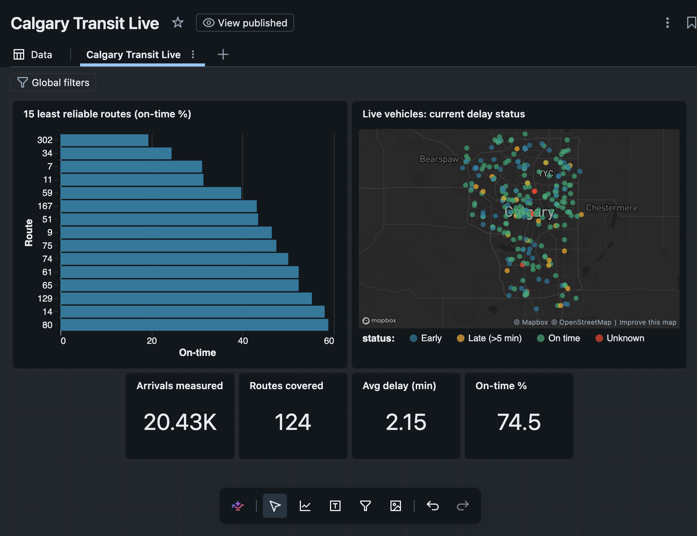

# Calgary Transit Live

How late is Calgary Transit, really? This project pulls Calgary Transit's real-time GPS feed every 30
seconds, compares each bus and train against the published schedule, and works out how late it was at
every stop. Everything after ingestion runs on Databricks.



From the first evening of data (Oct 16, 2026): 20,430 stop arrivals measured across 124 routes,
74.5% on time (1 min early to 5 min late), average delay 2.15 min. Route 302 was the least reliable
that evening at about 19% on time, though that's a small sample. The numbers update hourly as more data
comes in.

## How it works

```
Calgary Open Data (GTFS-realtime, protobuf)
        |
        |  poller.py - polls every 30 s, decodes, writes 5-min gzipped JSON batches
        v
Unity Catalog Volume (landing)
        |
        |  Auto Loader
        v
Bronze   raw feed tables, plus the static schedule (one table per GTFS file, per version)
        |
        v
Silver   cleaned vehicle positions (+ quarantine), latest stop predictions (MERGE),
         schedule expanded to every trip/stop/day, stop events with actual vs scheduled time
        |
        v
Gold     fact_stop_event, fact_trip_summary, route/stop/date/time dimensions,
         dashboard aggregates, data quality results
```

An hourly Databricks job runs the five notebooks in order. The poller runs outside Databricks because
Free Edition doesn't allow outbound internet from serverless compute, so something else has to fetch the
feed and land files.

### Ingestion

`poller/poller.py` fetches vehicle positions, trip updates and alerts, decodes the protobuf with
`gtfs-realtime-bindings`, and buffers one JSON line per entity. Every 5 minutes it writes a gzipped file
per feed and uploads it to the Volume through the Databricks Files API. Batching matters here: one file
per poll would be about 8,600 small files a day.

Files go to a local spool folder first and are only deleted after the upload succeeds, so if the
network or Databricks is down nothing is lost. Polls where the feed timestamp hasn't changed are skipped.

### Bronze

Auto Loader with an explicit schema. The entity itself is stored as a raw JSON string, so if Calgary
Transit adds fields, Bronze doesn't break. Parsing happens in Silver. Runs with `availableNow`, so each
job run picks up only new files and exits.

### Silver

- **Positions:** parsed, deduplicated on (vehicle, timestamp) with a 30-minute watermark (the feed repeats a
  vehicle's last ping when it hasn't moved), and checked against rules like "inside Calgary" and
  "timestamp not in the future". Failures go to a quarantine table with a reason instead of being dropped.
- **Predictions:** trip updates are exploded to one row per upcoming stop, and a MERGE keeps only the newest
  prediction per trip and stop.
- **Schedule:** every schedule zip is kept as a version with valid-from/valid-to dates (SCD type 2), then
  expanded using `calendar.txt` and `calendar_dates.txt` into one row per service date, trip and stop.
  GTFS times can go past 24:00 (`25:30:00` = 1:30 AM next day), so those are converted carefully into UTC.
- **Stop events:** for each scheduled stop, the actual arrival time comes from one of two methods:
  1. the last arrival prediction seen before the stop dropped out of the feed
  2. the GPS ping closest to the stop, within 75 m

  The two agree within a minute about 75% of the time, which I use as a sanity check on both.

To avoid comparing every ping with every stop, coordinates are bucketed into ~100 m grid cells and each
stop is copied into its 9 surrounding cells. The spatial match becomes a normal join on (trip, cell),
and the haversine distance is only computed for nearby pairs.

The last two service days are recomputed on every run (`replaceWhere`), which handles late data and
makes reruns safe.

### Gold

A small star schema (`fact_stop_event` at one row per trip per stop, plus route, stop, date and time
dimensions) and pre-aggregated tables for the dashboard.

## Things that broke along the way

- **The documented feed URL is dead.** Every GTFS directory I checked lists
  `transitdata.calgary.ca/ctransit/*.pb`, which just times out. The feeds now live behind
  `data.calgary.ca/download/<dataset-id>/...`.
- **Truncated downloads.** The portal sometimes serves the file while it's being rewritten, and the
  protobuf won't parse. The poller now waits a few seconds and re-downloads.
- **Delays of -56 years.** The plausible-delay check flagged about 1,200 arrivals averaging -29 million
  minutes. The feed sends `arrival.time = 0` when it only knows the delay, and 0 converts to 1970. Treating
  non-positive times as missing and falling back to scheduled time plus delay fixed it, and recovered
  ~500 arrivals that had been thrown away.
- **Out-and-back routes.** Buses pass within 75 m of stops they serve later in the same trip (the other side
  of the road), which showed up as arrivals 30-50 minutes early. Geo matches now have to fall within
  20 minutes early to 90 minutes late of the scheduled time.
- **Spark won't nest `explode()` inside arithmetic**, which my first version of the grid join did.

## Data quality

Each run appends to `transit_gold.dq_results`. After the first evening:

| Check | Pass rate |
|---|---|
| Vehicle positions passing validation | 99.99% |
| Delays within -30 to +120 min | 89%, before the fix above |
| GPS and prediction methods agree within 60 s | 75% |
| Scheduled stops with a detected arrival | 24% (low because most trips were only partly observed) |

## Running it

You need a Databricks workspace (Free Edition works) and a personal access token.

```bash
python3 -m venv .venv && .venv/bin/pip install -r poller/requirements.txt
cp .env.example .env        # fill in DATABRICKS_HOST and DATABRICKS_TOKEN
set -a; source .env; set +a
```

Create the schemas and Volume by running `notebooks/00_setup.sql`, then:

```bash
.venv/bin/python poller/poller.py --check    # checks credentials and that the Volume exists
.venv/bin/python poller/poller.py --static   # uploads the schedule
./poller/run_poller.sh                       # starts polling (leave this running)

.venv/bin/python tools/deploy_notebooks.py   # copies notebooks into the workspace
.venv/bin/python tools/create_job.py         # creates the hourly job and starts a run
```

There's also a `databricks.yml` if you'd rather deploy with Asset Bundles. Dashboard queries are in
`dashboards/dashboard_queries.sql`.

## Layout

```
poller/       real-time ingestion (runs on any machine with Python)
notebooks/    the Databricks pipeline, 00 to 06, plus shared config
tools/        scripts that deploy notebooks and create the job through the REST API
dashboards/   SQL behind the dashboard
docs/         screenshot and notes
```

## Stack

Databricks (serverless, Unity Catalog), Delta Lake, PySpark, Structured Streaming, Auto Loader,
Spark SQL, Lakeflow Jobs, AI/BI dashboards, Python, Protocol Buffers.

Data from City of Calgary Open Data under the Open Government Licence – City of Calgary. Not affiliated
with Calgary Transit.
